# (LGE Only) FOSSLight Scanner Service 

## Overview
{: .left-bar-title}
Source, binary and dependency analysis is performed using [FOSSLight Scanner](https://fosslight.org/fosslight-guide-en/scanner/) as a web service. Analysis results are generated in the form of a [FOSSLight Report](https://fosslight.org/hub-guide-en/learn/2_fosslight_report.html).    
- URL : [http://fs.lge.com](http://fs.lge.com)
- Supported items
    - [FOSSLight Source Scanner](https://fosslight.org/fosslight-guide-en/scanner/2_source.html)
    - [FOSSLight Binary Scanner](https://fosslight.org/fosslight-guide-en/scanner/3_binary.html)
    - [FOSSLight Dependency Scanner](https://fosslight.org/fosslight-guide-en/scanner/1_dependency.html)
        - Supported : npm, pypi, maven, pub, go, nuget, cargo, swift, carthage
          (Other package managers are currently undergoing verification)  
- Not supported items
    - [FOSSLight Android Scanner](https://fosslight.org/fosslight-guide-en/scanner/android/)
    - [FOSSLight Yocto Scanner](https://fosslight.org/fosslight-guide-en/scanner/yocto/)

## How to use
{: .left-bar-title}

### Login
{: .specific-title}
- You can access it by entering your AD account ID and password at [http://fs.lge.com](http://fs.lge.com) 
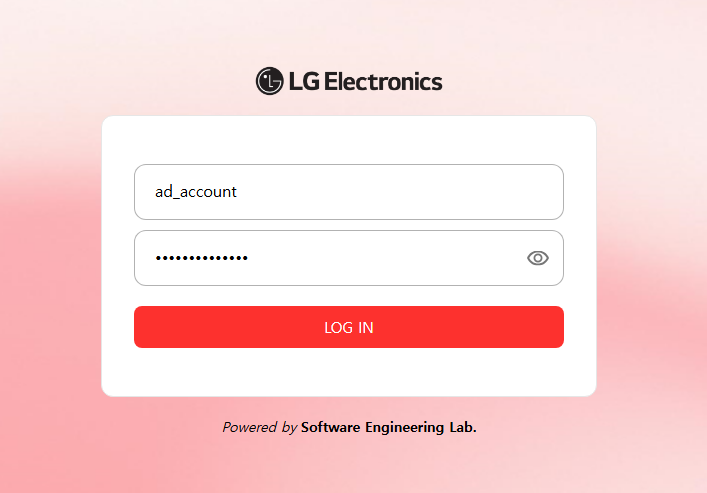{: .styled-image}  

### Create a Project 
{: .specific-title} 
1. Click the "New Project" button in the upper right corner to create a project.  
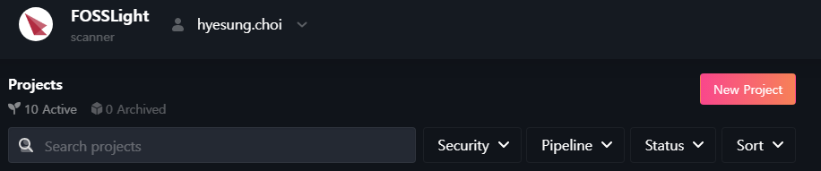{: .styled-image}  

2. Enter the contents in "Create a Project".  
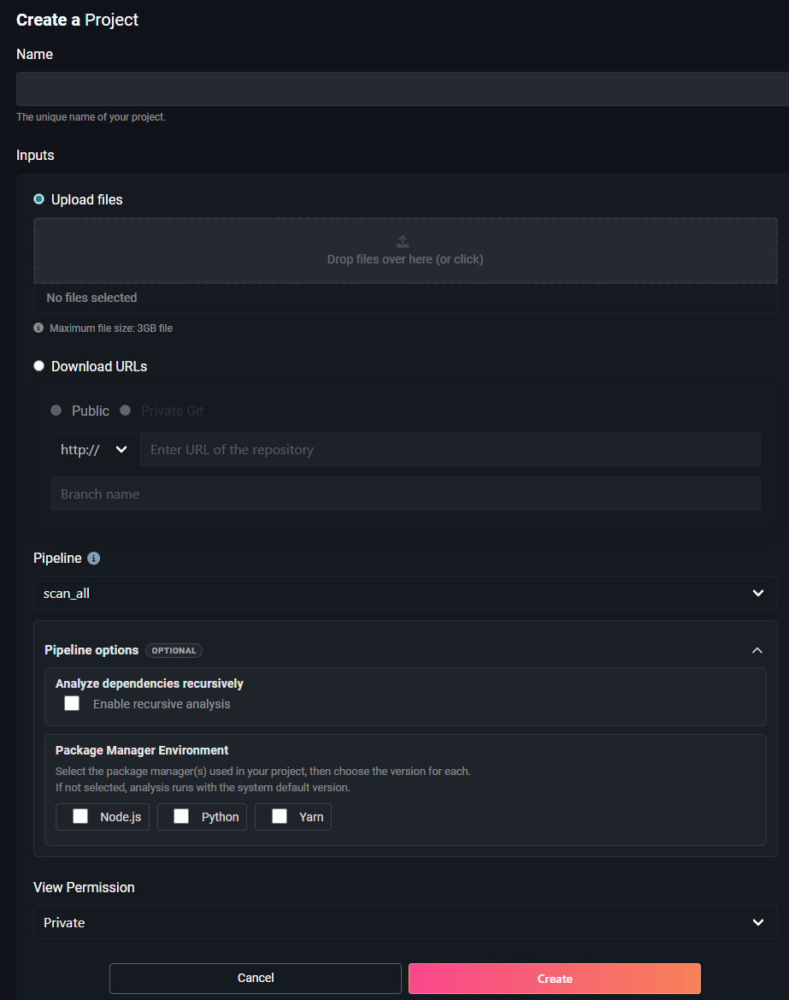{: .styled-image}  
    - **Name** :  Enter the Project name.
    - **Inputs** : Select sources to analyze.
        - **Upload files** : Compress and upload files to be analyzed. (Please upload only 1 file.)  
               ⚠️ You can upload up to 3GB.
        - **Download URLs** :  Enter the source link to be analyzed (link that can be obtained through "wget" or "git clone")    
            - **Public** 
                - The example of input value
                    - wget : github.com/LGE-OSS/example/archive/refs/tags/v1.0.0.zip
                    - git clone : github.com/LGE-OSS/example
            - **Private Git** 
                - **http://** or **https://** : You must enter the user name and PAT value.
                - **ssh://** : Copy the provided ssh key value and register it in your private git repository. ⚠️ Please use PAT instead of ssh for github.    
                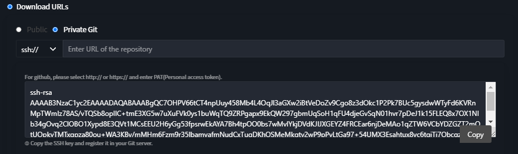{: .styled-image}  
    - **Pipeline**
        - scan_all : Analyze source, binary, dependency.
        - source : Analyze only the source code.
        - binary : Analyze only binary.
        - dependency : Analyze only dependency.
    - **Pipeline options (Optional)**
        - Analyze dependencies recursively : To analyze dependencies recursively by detecting manifest files in all subdirectories as well as the project's top-level directory, check the 'Enable recursive analysis' checkbox.
        - Package Manager Environment : If you want to use a specific version of a package manager during dependency analysis, select the language or package manager, and then choose your desired version from the version list.
    - **Permission**
        - Private : Only the creator can view.
        - Public : Other people can view the project and download analysis results through the link.

### Analysis Result
{: .specific-title}

From 3.0.0, open a finished analysis from the counts on the project page. The screen is a tree on the left and an OSS table on the right, and that is where you review detections and Identify them.  
Identify stores the OSS name, version, license, download location, comment, and exclude flag you confirm on top of the scanner values. The saved values are matched again after a later analysis, by path for a file and by purl for a dependency, and they are included in the FOSSLight Report you upload during [FOSSLight Hub Identification](https://fosslight.org/hub-guide-en/tutorial/1_project/2_Identification/).

Only the project creator, an editor added in Settings, and an admin can Identify. Everyone else can read the values. Identify is also closed while an analysis is running or the project is archived.

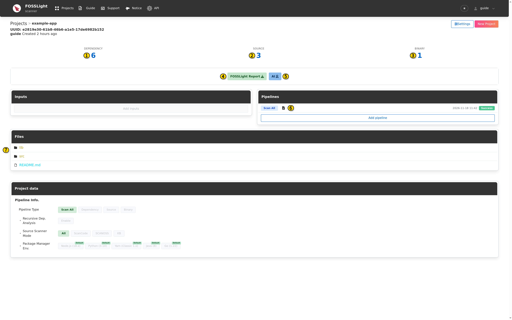{: .styled-image}

1. **Dependency** : Number of detected packages. The number opens the Dependency tree.
2. **Source** : Number of source files with OSS. The number opens the Source file tree.
3. **Binary** : Number of binary files. The number opens the Binary file tree. A count of 0 does not open that screen.
4. **FOSSLight Report** : The report to upload in Hub Identification. After you have saved an identification, the download includes those confirmed values. Before any identification, it is the scanner report.
5. **AI** : Summary of the analysis, with risk level and recommended actions.
6. **Log** : The icon beside a pipeline run. It downloads that run's log. The Download menu on the project list also offers the log and the report.
7. **Files** : The uploaded files and folders. An item opens the file tree. Packages found by dependency analysis are not in this list. Open them from count 1.

#### Result screen
{: .specific-title}

The counts open the screen below. The tabs switch among Dependency, Source, Binary, and Source + Binary. Moving between Source and Binary keeps the path and the filters you were using. Dependency is a separate tree.

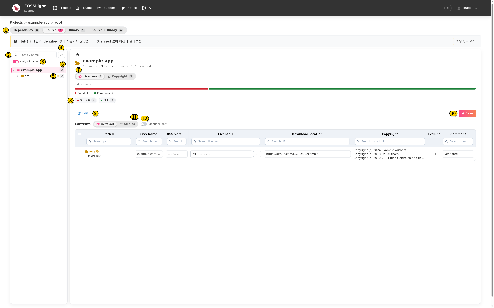{: .styled-image}

1. **Result tabs** : Dependency, Source, Binary, and Source + Binary. The counts are packages, source files with OSS, binary files, and the last two added together. A tab whose count is 0 cannot be opened. Moving between Source and Binary keeps the path and the filters you were using.
2. **Filter by name** : keeps loaded items whose name contains the text.
3. **Only with OSS** : on the Source and Binary trees, shows only files that have OSS. Turn it off to show files with no detection.
4. **Collapse / expand** : collapses or expands every loaded folder. Drag the boundary between the tree and the right pane to resize it.
5. **Status dot** : the dot beside a name. Blue is Scanned and yellow is Identified. A dot that is only half yellow is Partly identified. Hover the dot to read the status.
6. **Folder count** : how many files below that folder have OSS.
7. **Licenses** : a bar and chips for the licenses found below the selected folder. The types run Copyleft, Proprietary, Unclassified, Weak Copyleft, Permissive, Proprietary Free.
8. **License chips** : the name keeps only paths with that license. The count lists the files with that license. A long list opens with **+ more**. Remove a selected license from the chip above the tree.
9. **Edit** : opens the dialog that changes every ticked row.
10. **Save** : stores values typed directly into the cells.
11. **By folder / All files** : By folder lists the folders and files directly inside the selection. All files lists every file below it, at any depth.
12. **Identified only** : keeps rows whose status is Identified.

The OSS table of the file tree. A search under a column header matches part of the cell and ignores case. When several columns have a search, a row has to match all of them.

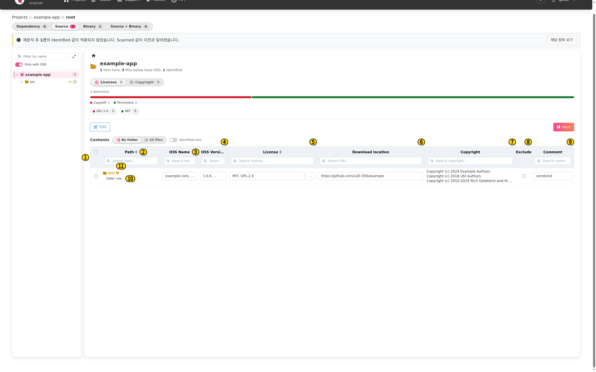{: .styled-image}

1. **Row selection** : the checkbox selects every row on the current page.
2. **Path**
3. **OSS Name**
4. **OSS Version**
5. **License** : **...** opens the FOSSLight license list. Several licenses are stored separated by commas.
6. **Download location**
7. **Copyright** : a long value is shortened. It comes from the scanner, so Identify does not change it. Hover the cell to see every copyright. When there are three or more lines, click to copy them.
8. **Exclude** : when checked, that row is left out of the FOSSLight Report.
9. **Comment**
10. **folder rule** : saving an edit on a folder row applies those values to every path below it that already has OSS. A value saved on a file wins over the folder rule. A row that receives the folder's values is marked **inherited**. A file with no OSS is left out of the rule.
11. **Info icon** : that path has been identified.

The Copyright tab.

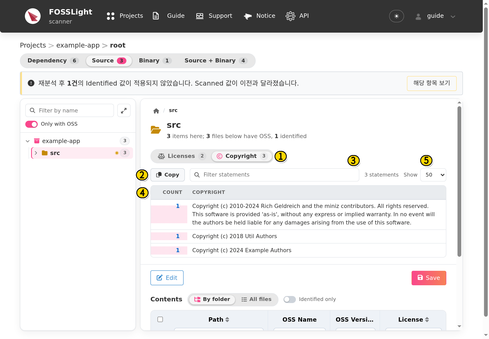{: .styled-image}

1. **Copyright** : the menu for checking copyrights.
2. **Copy** : copies every copyright that is shown.
3. **Search**
4. **COUNT** : how many files show that statement. On the Dependency screen the count is packages. Choosing a statement lists only the items that contain it.
5. **Page size** : how many copyrights one page shows.

The Dependency tree.

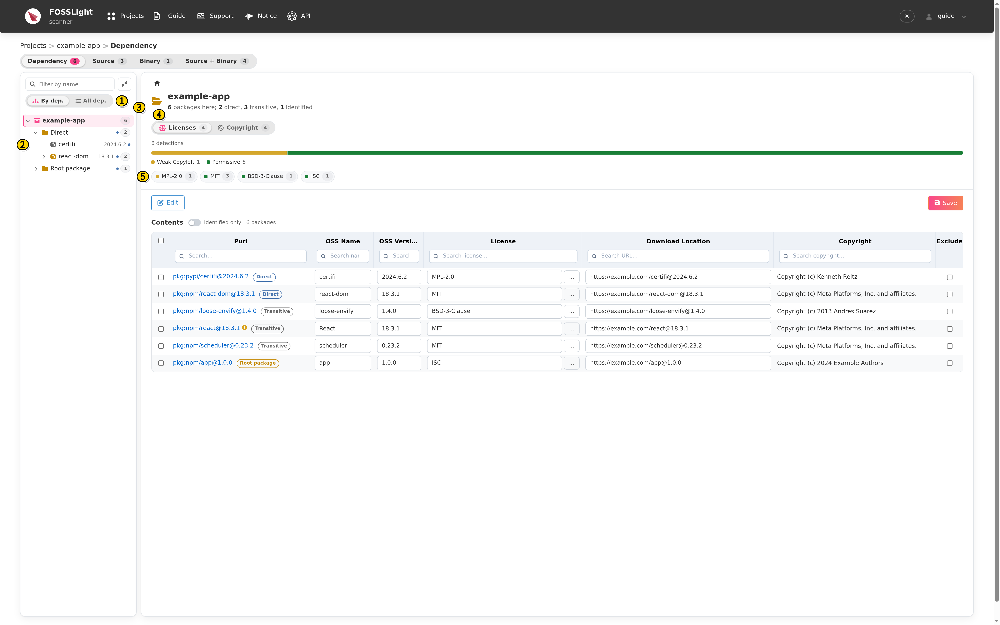{: .styled-image}

1. **By dep. / All dep.** : By dep. shows the dependency relationship from the packages under Direct. All dep. lists the packages in the Direct, Transitive, and Root package groups, and shows each package only once even when it would otherwise appear more than once.
2. **Direct** : the Direct packages. Transitive and Root package are in the same tree.
3. **Package count** : how many packages are below that node.
4. **Licenses** : the license tab for the selected group. Same as 7 on the file tree.
5. **License chips** : same as 8 on the file tree.

The Dependency OSS table. It has no Comment column. Open a package to read Comment on its card.

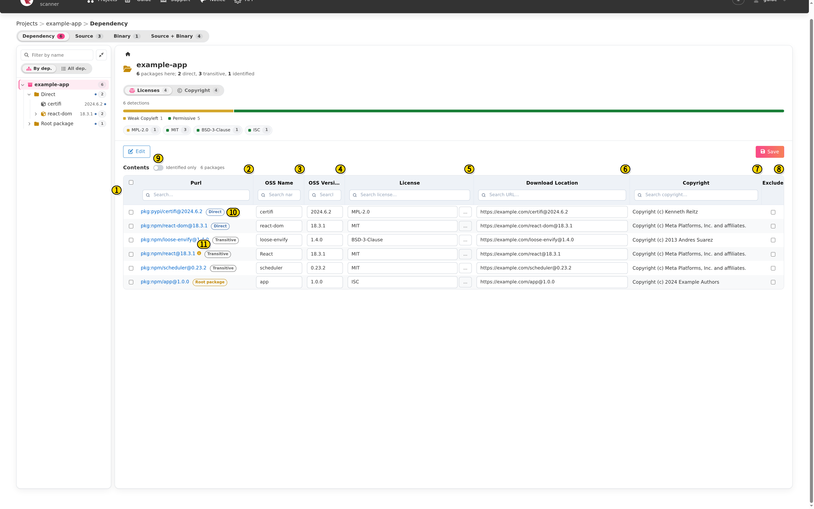{: .styled-image}

1. **Row selection**
2. **Purl**
3. **OSS Name**
4. **OSS Version**
5. **License**
6. **Download Location**
7. **Copyright**
8. **Exclude**
9. **Identified only** : same as 12 on the file tree.
10. **Relationship badge** : Direct, Transitive, or Root package.
11. **Info icon** : that package has been identified.

A file card. Selecting a package opens the same OSS fields, plus **Depends on** and **Required by**, so you can follow the dependency links.

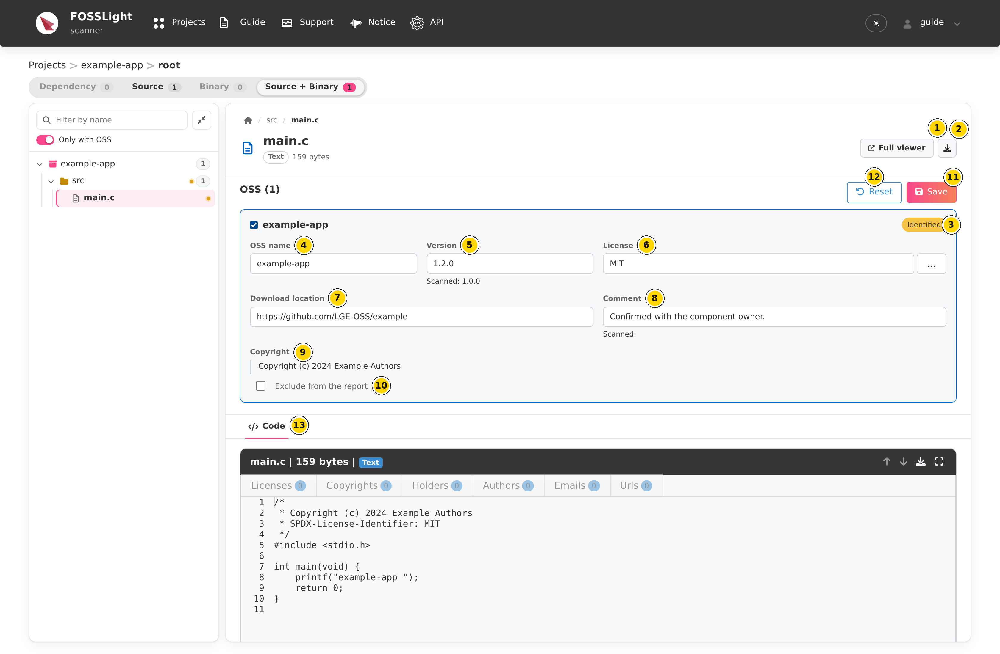{: .styled-image}

1. **Full viewer** : the menu for checking the details of the file.
2. **Download**
3. **Identified / Scanned** : Identified means a saved value differs from the scanner. Scanned means the row is still the scanner value.
4. **OSS name**
5. **Version**
6. **License** : **...** on the right opens the license list, where you select the license you used.
7. **Download location**
8. **Comment**
9. **Copyright**
10. **Exclude from the report** : the same flag as Exclude in the table.
11. **Save**
12. **Code** : highlights the matched lines.

#### Identify
{: .specific-title}

1. Edit a row directly, then press **Save**. The file card works the same way.
2. To change several rows together, tick the checkbox at the start of each row and press **Edit**. The checkbox selects every row on the current page.

    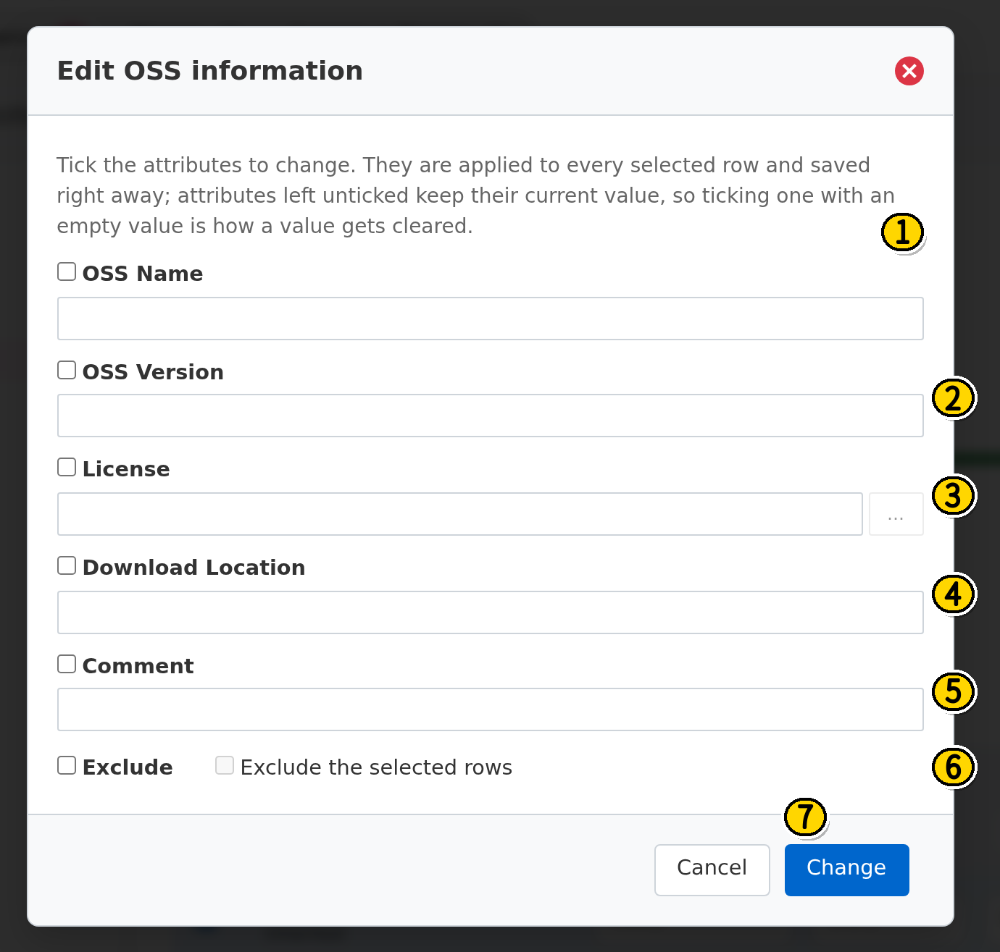{: .styled-image}

    1. **OSS Name**
    2. **OSS Version**
    3. **License**
    4. **Download Location**
    5. **Comment**
    6. **Exclude**
    7. **Change**

    Tick only the fields you want to change. Those fields are saved immediately on every selected row. Fields you leave unticked stay as they are. To clear a value, tick that field, leave it empty, and press 7, **Change**.
3. On License, press **...**, filter the list, select one or more licenses, and press **Apply**.

    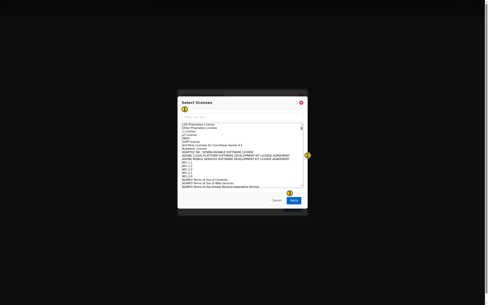{: .styled-image}

    1. **Filter the list**
    2. **License list** : select one or more.
    3. **Apply**

If nothing is selected, or nothing has changed, the button tells you there is nothing to save.

#### Values a re-analysis did not apply
{: .specific-title}

When you analyze again and the scanner value is no longer the Scanned value from the time you identified the row, the saved Identified value is not applied automatically. The screen shows the new scanner value and a warning above the table.

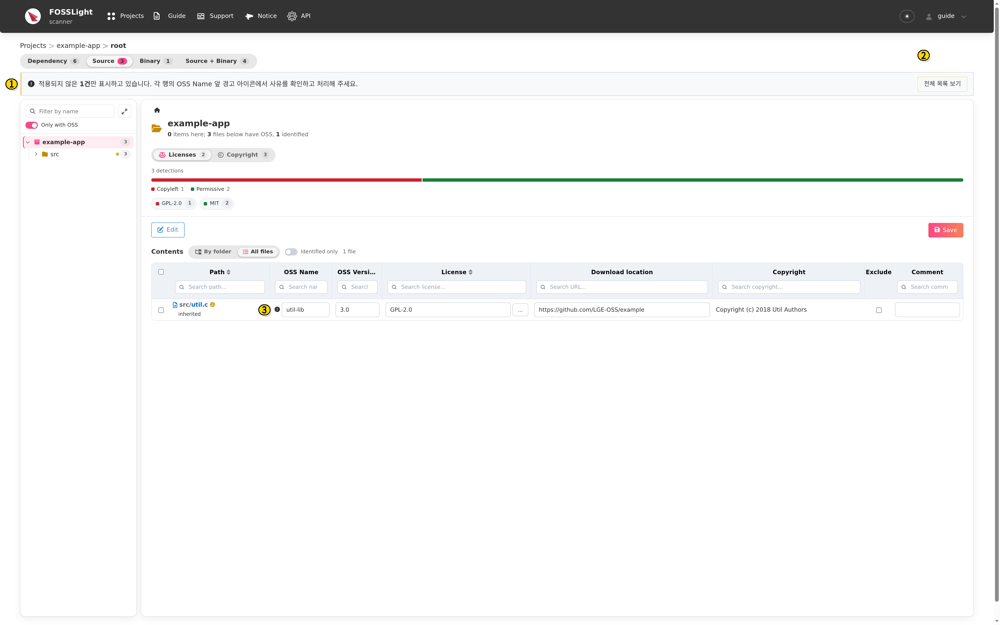{: .styled-image}

1. **Warning** : tells you how many identifications a re-analysis did not apply. The banner text is in Korean.
2. **해당 항목 보기 / 전체 목록 보기** (show these rows / show the full list) : show these rows keeps only the rows that were not applied. While that filter is on, the button changes to show the full list.
3. **Warning icon** : in front of OSS Name. It compares the previous Scanned value, the new Scanned value, and the Identified value.

    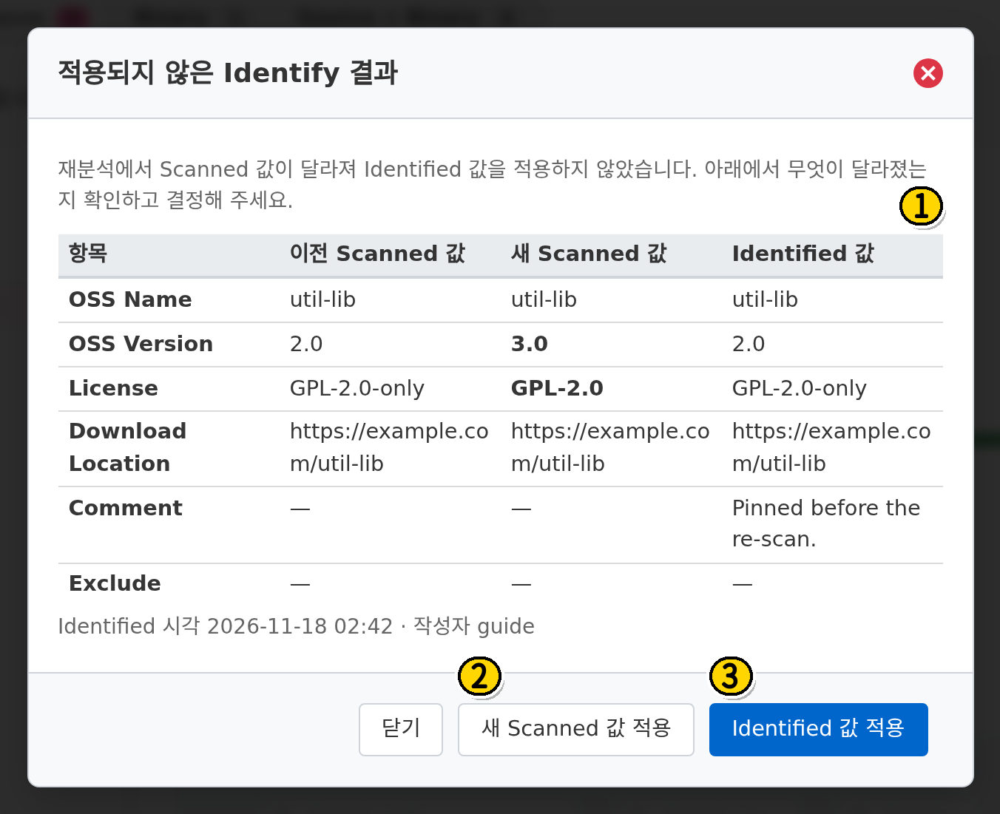{: .styled-image}

    1. **Comparison** : previous Scanned value, new Scanned value, and Identified value side by side. A value that changed is shown in bold. The dialog is in Korean.
    2. **새 Scanned 값 적용** (apply the new Scanned value) : drops the saved Identified value and keeps the new scanner value.
    3. **Identified 값 적용** (apply the Identified value) : puts the saved Identified value back on top of the new scanner value.

A record whose path or purl is absent from this analysis stays off the list and out of the warning count. It comes back when that path or purl is found again.  

