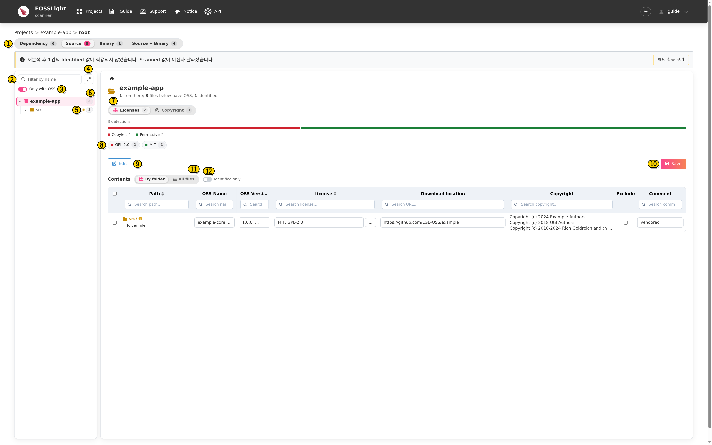
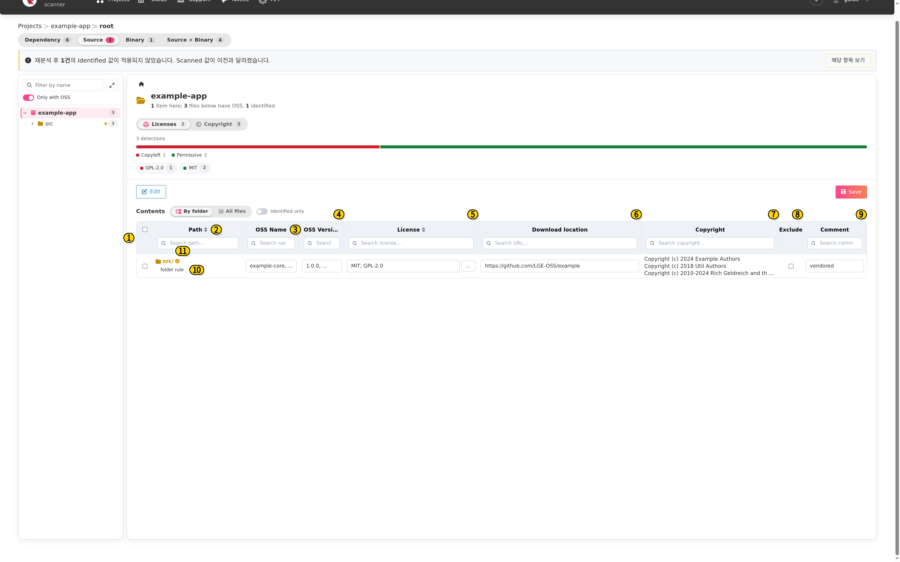
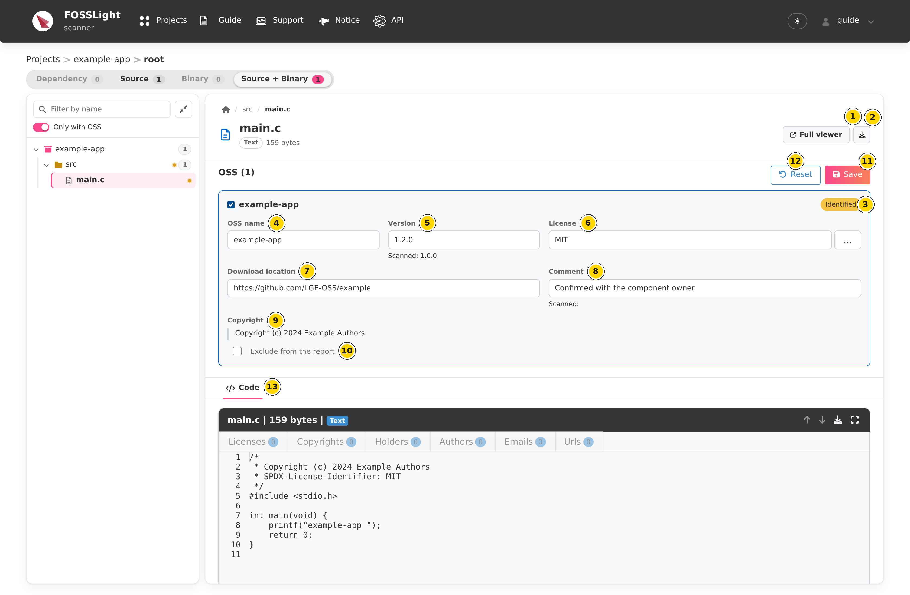
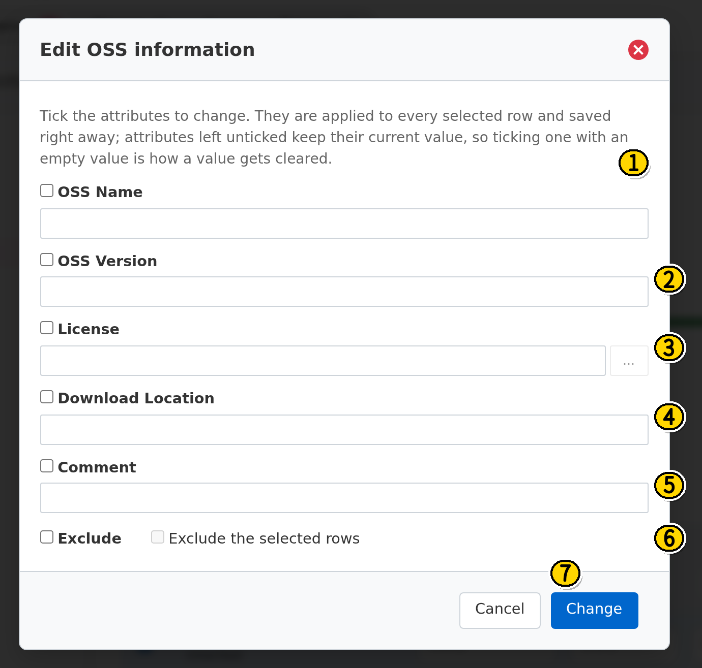
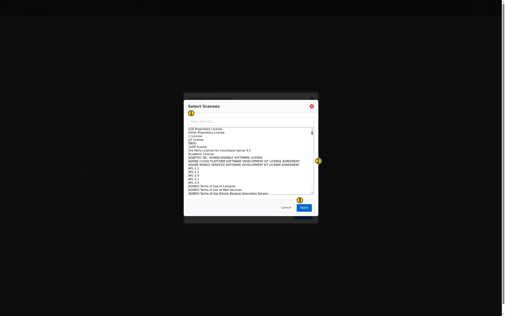
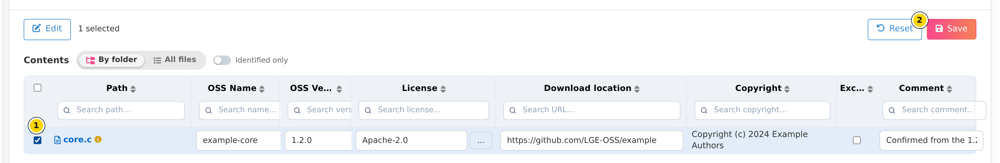
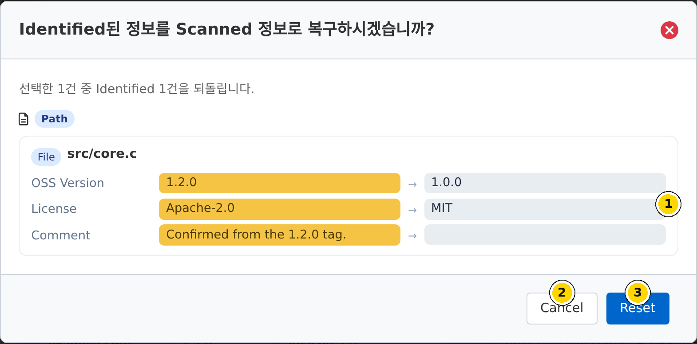
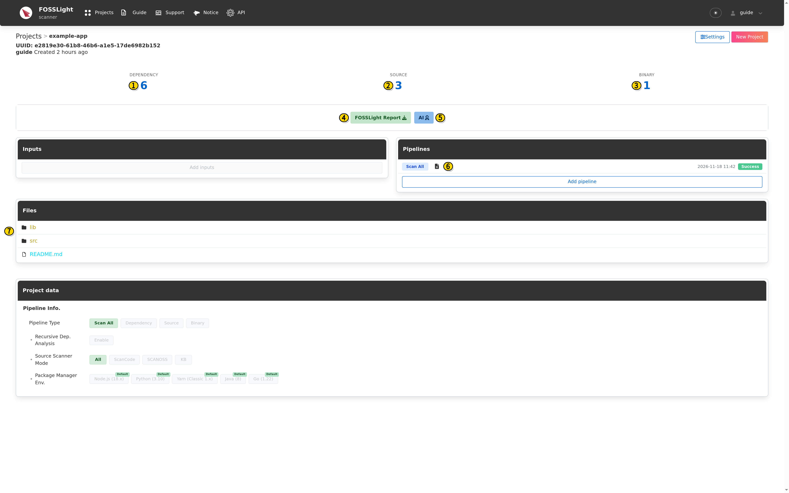
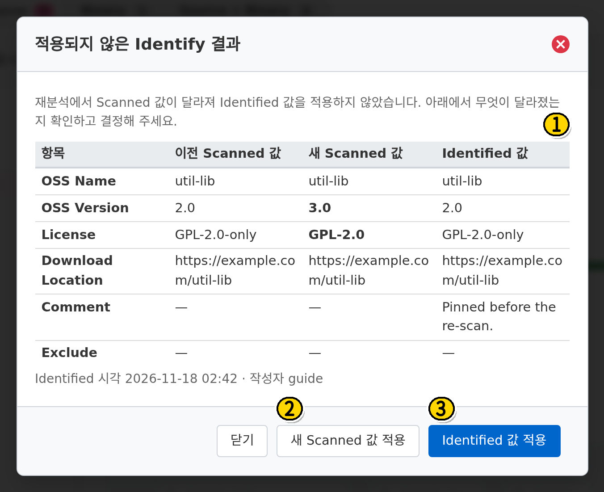

# What is Identify?

> **Notice**  
> **Reset** has been added to the OSS table. It removes an Identified value saved on the row itself and returns that row to the Scanned value from this analysis. See [Reset](#identify-reset).

On the analysis result screen, Identify is how you review the OSS information the scanner analyzed, correct the OSS information that needs a change, and save it.

The information that is saved is OSS Name, OSS Version, License, Download location, Comment, and Exclude. Copyright stays the scanned value, so Identify cannot change it.

Identified information is kept apart from the scanned result.  
When you analyze the same project again, the saved identified information appears by path for a file and by purl for a dependency.  
If any identified information is in effect, the [FOSSLight Report](https://fosslight.org/hub-guide-en/learn/2_fosslight_report.html) download is the report that includes those values.  
- Downloaded report name: **fosslight_report_YYMMDD_{part of the UUID}.xlsx**

When the Identify work is finished, upload this report during [FOSSLight Hub Identification](https://fosslight.org/hub-guide-en/tutorial/1_project/2_Identification/).

## Who can use Identify?
{: .left-bar-title}

A project Creator or Editor can use it. Editors are added and removed in Settings.

Identify cannot be used in these cases.

- An analysis is queued or running.
- The project is archived.

## How to use Identify
{: .left-bar-title}

Press the Dependency, Source, or Binary count on the project page. The result screen below opens.

< Path >  
A file identification is stored on the path. Opening the same file from Source, Binary, or Source + Binary shows the same saved values. Moving between Source and Binary keeps the path and the filters you were using.

< Dependency >  
A dependency identification is stored on the purl. It is separate from a folder rule on the file tree.

{: .styled-image}

1. **Result tabs** : choose Dependency, Source, Binary, or Source + Binary.
2. **Filter by name** : keeps loaded items whose name contains the text.
3. **Only with OSS** : on the Source and Binary trees, shows only files that have OSS. Turn it off to show files with no detection. A file with no OSS is left out of a folder rule.
4. **Collapse / expand** : collapses or expands every loaded folder.
5. **Status dot** : blue means scanned, and yellow means identified. (Details below.)
6. **Folder count** : how many files below that folder have OSS.
7. **Licenses** : a bar and chips for the licenses found below the selected folder.
8. **License chip** : the name keeps only paths with that license. The count lists the files with that license.
9. **Copyright** : for the selected path, you can check how often each copyright appears, and you can copy them.
10. **Edit** : opens the dialog that edits several rows at once.
11. **Save** : stores values typed directly into the cells. **Reset**, to its left, removes an Identified value saved on the selected row and returns that row to the Scanned value.
12. **By folder / All files** : By folder lists the folders and files directly inside the selection. Editing a folder row writes the folder rule. All files lists every file below it, at any depth.
13. **Identified only** : keeps rows whose status is Identified.

A search under a column header matches part of the cell and ignores case.  
When several columns have a search, a row has to match all of them.

## How to check the status
{: .left-bar-title}

A row's status depends on whether the values on screen match the analysis result (Scanned).

- **Scanned** : the values on screen match this analysis. On the file tree the dot is blue.
- **Identified** : the item has been identified. On the file tree the dot is yellow. The file card shows an Identified or Scanned tag.
- **Partly identified** : this status is only for a folder dot, and the yellow fill is only half the dot. Only some of the files with OSS below that folder are identified, and the folder has no folder rule. Hover the dot to read the status.
    - The folder dot is yellow when a folder rule covers it, or when every file with OSS below it is identified.
    - The info icon beside a Path or Purl means identified information is saved for that path or package. Hover shows Identified.
    - A file with no OSS has no dot, and a folder rule does not cover it.

{: .styled-image}

## Information you enter in Identify
{: .left-bar-title}

| Column | What to enter |
| --- | --- |
| OSS Name | The OSS name actually used. |
| OSS Version | The OSS version you can confirm from a tag in the repository. |
| License | The license you confirm. Write several licenses separated by commas. Reordering them is not treated as a change. |
| Download location | A URL from which the source code can be downloaded. |
| Comment | A note about the confirmation. |
| Exclude | When checked, that row is left out of the FOSSLight Report. **Exclude from the report** on the file card is the same flag. |
| Copyright | The scanned value, so it cannot be edited. A long value is shortened. Hover the cell to see every copyright. When there are three or more lines, click to copy them. |

A field you leave untouched keeps the Scanned value when you press **Save**. Clearing a field and saving stores that field as empty.

Saving an identified value back to the previous scanned value, or pressing **Reset**, deletes the identification, and the row returns to Scanned.

When the scanner finds more than one OSS on a path, the table lists a row for each OSS, and each OSS is saved on its own.

If nothing is selected, or nothing has changed, the button tells you so. The messages are `Select at least one row to edit.` and `There are no changes to save.`

## How to identify
{: .left-bar-title}

### Identify one package or file
{: .specific-title}

1. Click one dependency or file.
2. Type the values to change directly on the OSS card. For License, type in the field or press **...** and choose from the list.
3. Press **Save**.
4. After the save, the screen reloads and the status updates.

{: .styled-image}

What the file card shows. The numbers match the screen above.

1. **Full viewer** : the menu for checking the details of the file.
2. **Download** : downloads the file.
3. **Identified / Scanned** : shows the status of the dependency or file.
4. **OSS name** : the open source software name.
5. **Version** : the open source software version.
6. **License** : type it, or press **...** on the right to open the license list and select one.
7. **Download location** : a URL from which the OSS can be downloaded.
8. **Comment** : the value written during the scan, or a note for information you need.
9. **Copyright** : the copyright found by the scan. It cannot be edited.
10. **Exclude from the report** : check it to leave the row out of the report.
11. **Save** : saves the values you entered.
12. **Reset** : removes an Identified value saved on this card and returns it to the Scanned value. It turns on only when that card's checkbox is selected.
13. **Code** : highlights the matched lines. Identified values are not matched again.

Selecting a package shows the same OSS card fields, plus **Depends on** and **Required by**, so you can check the dependency relationship.

### Identify several packages or paths at once (Bulk Edit)
{: .specific-title}

1. In the OSS table, tick the checkbox at the start of each row you want to change together. The checkbox in the table header selects every row on the page.
2. Press **Edit**.
3. Tick only the fields you want to change. Fields you leave unticked stay as they are on every selected row.
4. Enter the information to change in each ticked field. To clear a value, tick that field and leave it empty.
5. Press **Change**. The ticked fields are saved immediately on every selected row.

{: .styled-image}

### Choose a license from the list
{: .specific-title}

In the OSS table and on the file card, press **...** directly.  
In Bulk Edit, **...** on License opens after you tick the License checkbox for that field.

1. Type in **Filter the list** to shorten the list.
2. Select one or more licenses.
   - A license that is not in the list can be typed into the License field.
3. Press **Apply**. The chosen licenses are written into the field.  
Then press **Save** or **Change** to store them.

{: .styled-image}

### Return a row to the Scanned value with Reset
{: #identify-reset .specific-title}

This removes an Identified value saved on the row itself and returns the row to the Scanned value from this analysis.

In the OSS table, select the rows to return. **Reset** turns on only when a selected row has a value saved on itself. **Reset** to the left of **Save** on a file card and on a dependency card does the same thing.

{: .styled-image}

1. **Row** : the row to return. Selecting it turns **Reset** on.
2. **Reset** : opens the confirmation.

{: .styled-image}

1. **Comparison** : yellow is the Identified value on screen, and gray is the Scanned value it will return to.
2. **Cancel** : changes nothing.
3. **Reset** : removes the saved value, and the status becomes Scanned.

Selected rows that are only Scanned stay as they are. If there are unsaved edits, you are asked whether to discard them first.  
Resetting a folder row removes that folder rule, and the paths the rule covered return with it. If a rule on a higher folder remains, that value applies again. A row that only inherits a folder rule is reset from that folder row.  
A row that a re-analysis did not apply is settled in the comparison dialog.

## Folder rule
{: .left-bar-title}

Identifying a folder row makes that the rule for the folder.  
With By folder, selecting a folder lists the folders and files under it in the OSS table. The folder row that holds the rule is marked **folder rule**.

On the Source and Binary tabs, the rule applies to paths below that folder that already have OSS.  
**A file with no OSS, and a dependency package, are left out of the rule.**

< Order >
1. The value you see first is the scanned value from the scanner.
2. Rules from a higher folder are not merged. The closest folder rule above the path is applied.
3. A value saved on that file row is the final value. An edit on the individual file takes priority over the folder rule.

A path covered by the folder rule is marked **inherited**. A row you saved on the file itself is not marked inherited, and that file's values take priority over the folder rule.

After you have identified a folder, saving the previous scanned value again, or pressing **Reset** on that folder row, removes the folder rule.  
Clearing every rule on a lower folder shows the rule from the higher folder again.

A folder rule stays in place after another analysis. A change in one file's scanner values does not put the folder rule itself on the warning list. Only a value saved on a file row goes through the re-analysis check below.

## What is different for Dependency
{: .left-bar-title}

{: .styled-image}

- The row key is **Purl**, not Path. The same purl in several manifests still has one identification.
- The **dependency badge** is Direct, Transitive, or Root package. It is separate from the identified values, and it cannot be edited.
- The info icon next to the purl means that package has been identified.
- It is not based on a path, so there is no folder rule.

By dep. shows the dependency relationship from the packages under Direct.  
All dep. lists the packages in the Direct, Transitive, and Root package groups, and shows each package only once even when it would otherwise be repeated. Either view saves the same purl.

## FOSSLight Report
{: .left-bar-title}

**FOSSLight Report** on the project page is the file you upload in Hub Identification.

- When an identified value is in effect, the download is the report that includes that value.
- When there is no identified value yet, the download is the scanned result as it is.
- A row with Exclude checked is left out of the report.
- The Download icon on the project list also offers the report.

When identified values have been saved back to the previous scanned values and no saved record remains, later downloads are the scanner report again.

## How to identify a project
{: .left-bar-title}

This is the order for reviewing the scan result of a finished project and entering the OSS information to correct.

### 1. Open the detailed result
{: .specific-title}

1. On the project page, press the Dependency, Source, or Binary count you want to review.
2. On Source and Binary, the tree on the left shows a file by its path. On Dependency, a package is shown by its purl.

{: .styled-image}

{: .styled-image}

{: .styled-image}

### 2. Find the rows to change with Identify
{: .specific-title}

1. Turn on **Only with OSS** to show only files that have a detected OSS in the tree.
2. Press a folder to list the folders and files directly inside it. Press **All files** to list further down.
3. The search under a column header filters by path, name, or license.

{: .styled-image}

### 3-1. Change one file or package
{: .specific-title}

Press one file or package.

1. On the OSS card, change OSS Name, Version, License, Download location, and Comment. For License, type in the field or press **...** and choose from the list.
2. Check **Exclude from the report** to leave that row out of the report. Copyright is the scanned value, so it cannot be changed.
3. Press **Save**. The screen reloads and the status becomes Identified.
- Tree color by status
    - Blue: Scanned
    - Yellow: Identified
        - A half-yellow dot means only some of the items below that folder are identified.

{: .styled-image}

### 3-2. Change several OSS rows at once
{: .specific-title}

Use this when the same correction applies to several files or packages.

1. In the OSS table, tick the checkbox of each row to change. The checkbox in the header selects every row on the page.
2. Press **Edit**.
3. Tick only the fields to change and enter the values. Fields you leave unticked stay as they are on the selected rows. To clear a value, tick that field and leave it empty.
4. Press **Change**. The values are saved immediately on the selected rows.

A row is Scanned when the values in the table match this analysis. It is Identified when a saved value differs.

A field you did not change stays as the Scanned value.

{: .styled-image}

### 3-3. Apply the same value to a folder
{: .specific-title}

Use this to apply the same OSS information to the files under one folder. A dependency has no folder rule.

1. On the Source or Binary tab, select the folder with **By folder**.
2. Edit the folder row in the table and save it. The row is marked **folder rule**.
3. Paths below that folder that already have OSS inherit the value and are marked **inherited**. A file with no OSS is left out.
4. A value saved on one file takes priority over the folder rule.
5. When a higher folder also has a rule, only the folder rule closer to the path applies.

To restore an applied rule, save the previous Scanned value on that folder row again, or press **Reset**.  
When every higher-priority rule on a lower folder is cleared, the rule from the higher folder shows again.  
An applied folder rule stays in place after another analysis.

{: .styled-image}

### 4. Return a saved value (Reset)
{: .specific-title}

Use this to return information you changed with Identify to the Scanned information.

1. In the OSS table, select the rows to return. On a file card or a dependency card, tick that card's checkbox.
- **Reset** turns on only when that row has a value saved on itself.
2. Press **Reset**. A dialog opens. Yellow is the Identified value, and gray is the Scanned value it will return to.
3. Press **Reset** to remove the saved value. The status becomes Scanned.

Selected rows that are only Scanned stay as they are.  
If there are unsaved edits, you are asked whether to discard them first.  
A row covered only by a folder rule is reset from that folder row.
- Resetting a folder row returns that rule and the paths it covered. If a rule on a higher folder remains, that value applies again.

{: .styled-image}

{: .styled-image}

### 5. Download the report and upload it to Hub
{: .specific-title}

1. On the project page, download **FOSSLight Report**. The Download icon on the project list also offers it.
- The file name is **fosslight_report_YYMMDD_{part of the UUID}.xlsx**.
2. When any Identified value is in effect, the report includes that value.
- When nothing has been saved, the report is the scanner result as it is.
- A row with Exclude checked is left out of the report.
3. Upload the file during [FOSSLight Hub Identification](https://fosslight.org/hub-guide-en/tutorial/1_project/2_Identification/).

{: .styled-image}

### When a re-analysis of the same project finds a value that differs from the Identified information
{: .specific-title}

When you analyze the same project again, the information saved for a file with the same path, or a package with the same purl, is shown as the **identified value, not the Scanned value**.

That value is shown again automatically only when the name, version, license, download location, comment, and exclude all match the saved values. If any of them differs, the screen shows the new scanner value and a warning appears above the table. Only people who can save (the creator and an editor) see this warning.

{: .styled-image}

1. **Warning** is how many identifications the re-analysis did not apply. The text is `재분석 후 N건의 Identified 값이 적용되지 않았습니다. Scanned 값이 이전과 달라졌습니다.`
2. Press **해당 항목 보기** (show these rows) to open only the rows that were not applied. The text then changes to `적용되지 않은 N건만 표시하고 있습니다.` and the button becomes **전체 목록 보기** (show the full list).
3. Press the warning icon in front of OSS Name and compare the previous Scanned value, the new Scanned value, and the Identified value. Until you settle the row here, the saved value stays unapplied.

{: .styled-image}

The dialog title is `적용되지 않은 Identify 결과`. A new Scanned value that changed is shown in bold, and the time of the identification and the author are shown underneath.

1. Press **새 Scanned 값 적용** (apply the new Scanned value) to use the new scan. The saved Identified value is removed and the new scanner value is used.
2. Press **Identified 값 적용** (apply the Identified value) to keep the saved value. That value is put back on top of the new scanner value, and later comparisons use this analysis as the baseline.
3. **닫기** (close) leaves the value as it is. The warning and the icon remain.

A record whose path or purl is absent from this analysis stays off the list and out of the warning count.
- If the first analysis was Source only, and the re-analysis runs Dependency, the Source result is not shown. Only the latest analysis, the Dependency result, is shown.

When the same path or purl is found in a later analysis, that record comes back.  
An analysis that runs only Source, only Binary, or only Dependency leaves saved values of the kinds it did not produce as they are. Running only Source again leaves the values saved on dependencies as they are. A folder rule is not removed by this warning, and it still applies to paths below that folder that have OSS.
