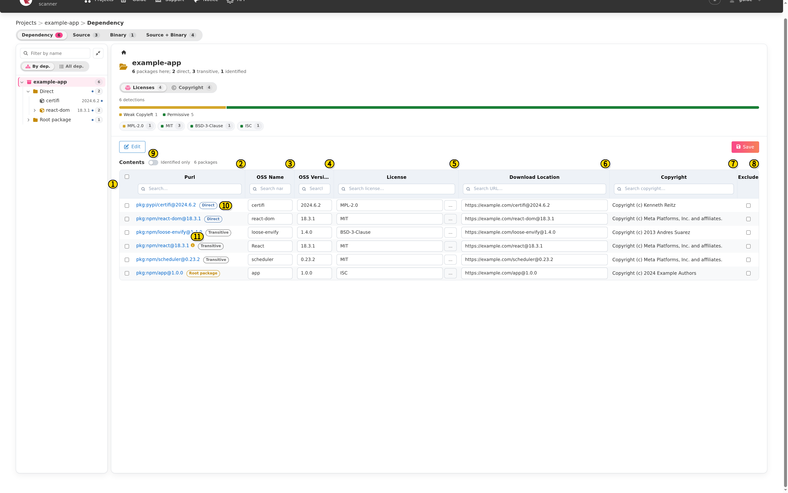
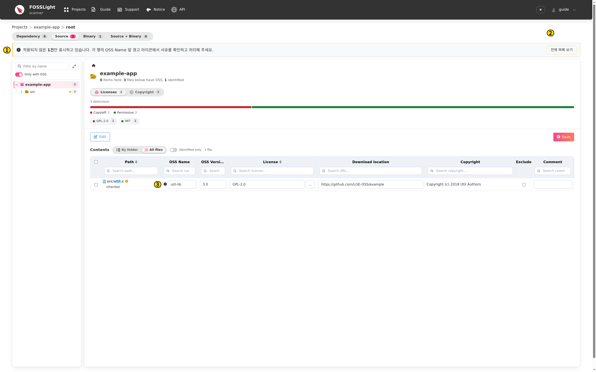

# What is Identify?

On the analysis result screen, Identify is how you review the OSS information the scanner analyzed, correct the OSS information that needs a change, and save it.

The information that is saved is OSS Name, OSS Version, License, Download location, Comment, and Exclude. Copyright stays the scanned value, so Identify cannot change it.

Identified information is kept apart from the scanned result.  
When you analyze the same project again, the saved identified information appears by path for a file and by purl for a dependency.  
If any identified information is in effect, the [FOSSLight Report](https://fosslight.org/hub-guide-en/learn/2_fosslight_report.html) download is the report that includes those values.  
When the Identify work is finished, upload this report during [FOSSLight Hub Identification](https://fosslight.org/hub-guide-en/tutorial/1_project/2_Identification/).

## Who can use Identify?

The project creator and an editor added in Settings can use it. Adding and removing editors is done in Settings by the creator or an admin.

Identify cannot be used in these cases.

- An analysis is queued or running.
- The project is archived.

## How to use Identify

Press the Dependency, Source, or Binary count on the project page. The result screen below opens.

< Path >  
A file identification is stored on the path. Opening the same file from Source, Binary, or Source + Binary shows the same saved values. Moving between Source and Binary keeps the path and the filters you were using.

< Dependency >  
A dependency identification is stored on the purl. It is separate from a folder rule on the file tree.

{: .styled-image}

1. **Result tabs** : choose Dependency, Source, Binary, or Source + Binary.
2. **Filter by name** : keeps loaded items whose name contains the text.
3. **Only with OSS** : on the Source and Binary trees, shows only files that have OSS. Turn it off to show files with no detection. A file with no OSS is left out of a folder rule.
4. **Collapse / expand** : collapses or expands every loaded folder.
5. **Status dot** : blue means scanned, and yellow means identified. (Details below.)
6. **Folder count** : how many files below that folder have OSS.
7. **Licenses** : a bar and chips for the licenses found below the selected folder.
8. **License chip** : the name keeps only paths with that license. The count lists the files with that license.
9. **Copyright** : for the selected path, you can check how often each copyright appears, and you can copy them.
9. **Edit** : opens the dialog that edits several rows at once.
10. **Save** : stores values typed directly into the cells.
11. **By folder / All files** : By folder lists the folders and files directly inside the selection. Editing a folder row writes the folder rule. All files lists every file below it, at any depth.
12. **Identified only** : keeps rows whose status is Identified.

A search under a column header matches part of the cell and ignores case.  
When several columns have a search, a row has to match all of them.

## How to read the status

A row's status is whether the values on screen still match the scanner.

- **Scanned** : the values on screen match this analysis. On the file tree the dot is blue.
- **Identified** : the item has been identified. On the file tree the dot is yellow. The file card shows an Identified or Scanned tag.
- **Partly identified** : this status is only for a folder dot, and the yellow fill is only half the dot. Only some of the files with OSS below that folder are identified, and the folder has no folder rule. Hover the dot to read the status.

The folder dot is yellow when a folder rule covers it, or when every file with OSS below it is identified.  
A file with no OSS has no dot, and a folder rule does not cover it.  
The info icon beside a Path or Purl means identified information is saved for that path or package. Hover shows Identified.

{: .styled-image}

## Information you enter in Identify

| Field | What is saved |
| --- | --- |
| OSS Name | The OSS name actually used. |
| OSS Version | The OSS version actually used (one you can confirm from the tag). |
| License | The license you confirm. Several licenses are stored separated by commas. Reordering them is not treated as a change. |
| Download location | A URL from which the source code can be downloaded. |
| Comment | A note about the confirmation. |
| Exclude | When checked, that row is left out of the FOSSLight Report. **Exclude from the report** on the file card is the same flag. |
| Copyright | The scanned value, so it cannot be edited. A long value is shortened. Hover the cell to see every copyright. When there are three or more lines, click to copy them. |

A field you leave untouched keeps the scanner value when you press **Save**. Clearing a field and saving stores that field as empty. Clearing License stores no license.

Saving an identified value back to the previous scanned value deletes the identification, and the row returns to Scanned.

When the scanner finds more than one OSS on a path, the table lists a row for each OSS, and each OSS is saved on its own.

If nothing is selected, or nothing has changed, the button tells you so. The messages are `Select at least one row to edit.` and `There are no changes to save.`

## Identify one package or file

1. Click one dependency or file.
2. Type directly in the table cells. For License, type in the cell or press **...** and choose from the list.
2. Press **Save**.
3. After the save, the screen reloads and the status updates.

{: .styled-image}

What the file card shows. The numbers match the screen above.

1. **Full viewer** : the menu for checking the details of the file. It is separate from the identified values.
2. **Download** : downloads the file.
3. **Identified / Scanned** : shows the status of this dependency or file.
4. **OSS name**
5. **Version**
6. **License** : type it, or press **...** on the right to open the license list and select one.
7. **Download location**
8. **Comment**
9. **Copyright**
10. **Exclude from the report** : check it to leave the row out of the report.
11. **Save**
12. **Code** : highlights the matched lines. Identified values are not edited here.

Selecting a package opens the same OSS fields, plus **Depends on** and **Required by**, so you can follow the dependency links.

## Identify several packages or paths at once (Bulk Edit)

1. Tick the checkbox at the start of each row you want to change together. The checkbox in the table header selects every row on the current page. Rows on another page are not included.
2. Press **Edit**.
3. Tick only the fields you want to change. Fields you leave unticked stay as they are on every selected row.
4. Enter the value for each ticked field. To clear a value, tick that field and leave it empty.
5. Press **Change**. The ticked fields are saved immediately on every selected row.

{: .styled-image}

## Choose a license from the list

In Bulk Edit, **...** on License opens after you tick the License field.  
In the OSS table and on the file card, press **...** directly.

1. Type in **Filter the list** to shorten the list.
2. Select one or more licenses.
3. Press **Apply**. The chosen licenses are written into the field, separated by commas. Then press **Save** or **Change** to store them.

{: .styled-image}

A license that is not in the list can be typed into the License field.

## Folder rule

Identifying a folder row makes that the rule for the folder. Select the folder with By folder so the folder row is in the table. The folder row that holds the rule is marked **folder rule**.

The rule applies to every path below that folder that already has OSS, on both Source and Binary.  
**A file with no OSS, and a dependency package, are left out of the rule.**

< Order >
1. The value you see first is the scanned value from the scanner.
2. Rules from a higher folder are not merged. The closest folder rule above the path is applied.
3. A value saved on that file row is the final value. An edit on the individual file takes priority over the folder rule.

A path covered by the folder rule is marked **inherited**. A row you saved on the file itself is not marked inherited, and that file's values take priority over the folder rule.

After you have identified a folder, saving the previous scanned value again removes the folder rule.  
Clearing every rule on a lower folder shows the rule from the higher folder again.

A folder rule stays in place after another analysis. A change in one file's scanner values does not put the folder rule itself on the warning list. Only a value saved on a file row goes through the re-analysis check below.

## What is different for Dependency

{: .styled-image}

- The row key is **Purl**, not Path. The same purl in several manifests still has one identification.
- The **dependency badge** is Direct, Transitive, or Root package. It is separate from the identified values, and it cannot be edited.
- The info icon means that package has been identified.
- It is not based on a path, so there is no folder rule.

By dep. shows the dependency relationship from the packages under Direct. All dep. lists the packages in the Direct, Transitive, and Root package groups, and shows each package only once even when it would otherwise be repeated. Either view saves the same purl.

## FOSSLight Report

**FOSSLight Report** on the project page is the file you upload in Hub Identification.

- When an identified value is in effect, the download is the report that includes that value.
- When there is no identified value yet, the download is the scanned result as it is.
- A row with Exclude checked is left out of the report.
- The Download icon on the project list also offers the report.

When identified values have been saved back to the previous scanned values and no saved record remains, later downloads are the scanner report again.

## After another analysis

An identified value on a file or package is shown again automatically only when this scan's name, version, license, download location, comment, and exclude values are the same.  
If any of those values differs, it is not shown as the identified information.  
The screen shows the new scanner value, and a warning appears above the table.

Only people who can save (the creator and an editor) see this warning.

{: .styled-image}

1. **Warning** : how many identifications a re-analysis did not apply. The banner text is `재분석 후 N건의 Identified 값이 적용되지 않았습니다. Scanned 값이 이전과 달라졌습니다.`
2. **해당 항목 보기** (show these rows) : keeps only the rows that were not applied. The banner then reads `적용되지 않은 N건만 표시하고 있습니다.` and the button changes to **전체 목록 보기** (show the full list).
3. **Warning icon** : in front of OSS Name. It opens the comparison. Until you settle the row there, the saved value stays unapplied.

{: .styled-image}

The dialog title is `적용되지 않은 Identify 결과`. The dialog is in Korean.

1. **Comparison** : previous Scanned value, new Scanned value, and Identified value side by side. A new Scanned value that changed is shown in bold. The time of the identification and the author are shown underneath.
2. **새 Scanned 값 적용** (apply the new Scanned value) : deletes the saved Identified value and uses the new scanner value.
3. **Identified 값 적용** (apply the Identified value) : puts the saved Identified value back on top of the new scanner value. Later comparisons use this analysis as the baseline.
4. **닫기** (close) : changes nothing. The warning and the icon remain.

A record whose path or purl is absent from this analysis stays off the list and out of the warning count. When **the same path or purl** is found in a later analysis, that record comes back.

An analysis that runs only Source, only Binary, or only Dependency leaves identified values of the kinds it did not produce as they are. A Source-only run does not drop values saved on dependencies.

A folder rule is not removed by this warning. After another analysis it still applies to paths below that folder that have OSS.
